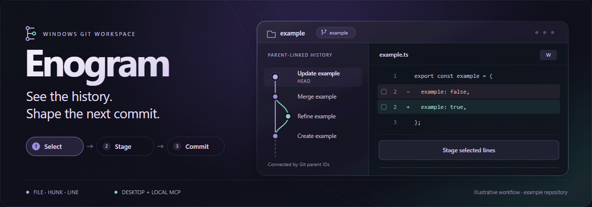
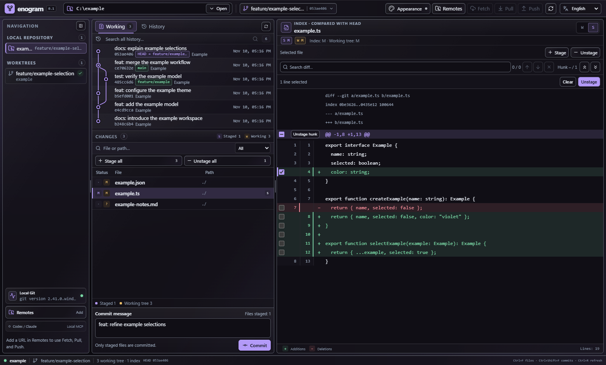
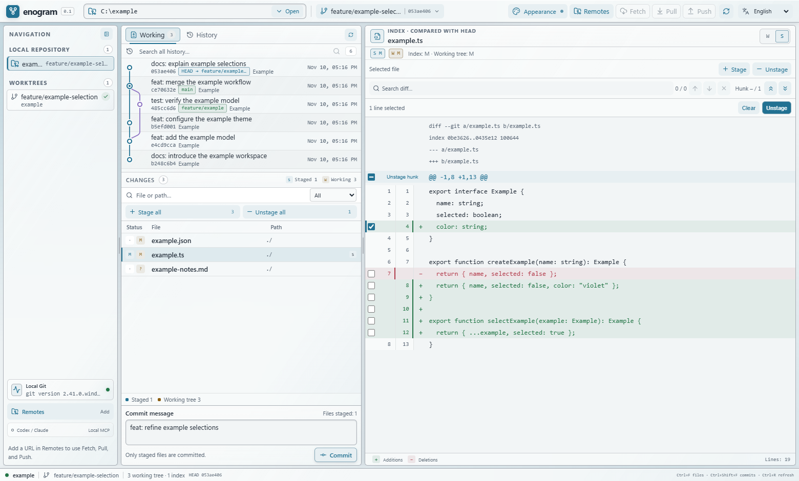

<div align="center">



# Enogram

### See the history. Choose the change. Own the workflow.

A Windows-first Git desktop built with **Tauri, React, and Rust**.<br />
Precise staging. Real commit graphs. Liquid-glass themes. Local MCP access.

[Get started](#get-started) · [The workspace](#the-workspace) · [MCP setup](docs/MCP.md) · [Roadmap](ROADMAP.md) · [MIT License](LICENSE)

**Windows x64** &nbsp; / &nbsp; **Early preview · 0.1.0** &nbsp; / &nbsp; **MIT**

<sub>The animation illustrates the workflow; it is not a recording. <a href="docs/media/enogram-hero.png">View the static version.</a></sub>

</div>

---

## The workspace

Your repository, commit history, working changes, and diff stay in one adjustable workspace. Review a change, choose exactly what belongs in the next commit, and keep the rest in your working tree.

<picture>
  <source media="(prefers-color-scheme: light)" srcset="docs/media/workspace-light.png" />
  <source media="(prefers-color-scheme: dark)" srcset="docs/media/workspace-dark.png" />
  
</picture>

<sub>Actual desktop screenshots in English, using the disposable <code>example</code> repository and the <code>Example</code> author.</sub>

## Built for deliberate commits

| Capability | What you can do today |
| --- | --- |
| **Precise staging** | Stage or unstage complete files, individual changed lines, entire hunks, or selections spanning multiple hunks. |
| **Real history** | Follow Git-derived parent edges, branches, merges, tags, and first-parent commit diffs. |
| **Find the change** | Search all locally reachable history by message, author/email, SHA, or ref. Search within a diff and jump between matches or hunks. |
| **Branch and sync** | Create/switch local branches, add/edit remotes, Fetch, fast-forward-only Pull, and Push an explicit branch. |
| **Make it yours** | Four palettes, light/dark glass surfaces, a color generator, four button styles, adjustable panels, and compact/comfortable density. |
| **Two interface languages** | Switch between English and Türkçe in the top bar. Your preference is saved, and open repositories, drafts, searches, and selections stay in place. |
| **Local MCP** | Let Codex, Claude Code, or Claude Desktop read allowed repositories and stage, unstage, or commit through the same Rust core. |

### Select → stage → review → commit

1. Open an existing checkout, for example `C:\example\repository`.
2. In **W**, select changed lines or use **Stage hunk** to stage a complete hunk.
3. In **S**, review the prepared changes. Use **Unstage** to take selected changes back out of the index.
4. Write a message and press **Commit**. Only the prepared index is committed.

Working files remain intact during stage/unstage. A replacement has a removed line and an added line; select both to stage the complete replacement. File-level actions still affect the entire current file.

Partial selections are bound to the displayed diff, repository state, and exact working-file bytes. If those inputs change, the old selection is rejected and the view refreshes. A failed Git write is never automatically retried.

## A workspace that fits

**Graphite** keeps it understated. **Aurora** adds violet glass. **Glacier** brings a bright surface. **Ember** turns up the warmth.

Choose a seed color to generate a readable light or dark palette. Tune opacity, blur, and button style independently. Code stays on an opaque background so the diff remains readable.

<details>
<summary><strong>Explore the light workspace</strong></summary>



Preferences are stored on your device. Panel widths, sidebar state, and density persist independently of the selected palette.

The language selector is always available in the top bar. Turkish is the default; choose **English** to use the interface shown above. Repository content and original Git diagnostics are displayed as written.

</details>

## Get started

Enogram is an early source preview. A public, signed installer release is not available yet; build the desktop or the unsigned Windows package locally.

For development, install **Node.js 24**, **Rust with the MSVC toolchain**, **Visual C++ build tools and Windows SDK**, **WebView2**, and **Git for Windows**.

```powershell
git clone https://github.com/baranmerez/Enogram.git
cd Enogram
npm ci
npm run tauri:dev
```

The desktop uses your installed Git and its configured identity, credentials, hooks, and signing settings. A browser-only Vite preview cannot access local repositories.

<details>
<summary><strong>Build a Windows installer</strong></summary>

```powershell
npm run installer:build
```

The package includes the desktop and `enogram-mcp.exe`. Output:

```text
target/installer/x86_64-pc-windows-msvc/release/bundle/nsis/Enogram_0.1.0_x64-setup.exe
```

The installed application needs Git for Windows and WebView2. Node.js and Rust are build-time requirements. Setup can download WebView2 when it is missing.

See [installation, updates, and removal](docs/INSTALLATION.md). The generated preview is unsigned.

</details>

## Local MCP, explicit access

The standalone MCP server works without opening the desktop. Each client starts a stdio process with an explicit repository allowlist. Read-only access is the default; `--allow-write` enables file-level stage/unstage and prepared-index commit.

```powershell
cargo build -p enogram-mcp
& .\target\debug\enogram-mcp.exe --repo C:\example\repository
```

Use `--allow-write` only when the client should write to the listed repositories. Clients must inspect current state before writing. MCP does not expose arbitrary shell commands, Push, destructive cleanup, or desktop hunk/line selection.

[Configure Codex, Claude Code, or Claude Desktop →](docs/MCP.md)

## Shortcuts

| Action | Shortcut |
| --- | --- |
| Find a file | `Ctrl+F` in the workspace |
| Find a commit across local history | `Ctrl+Shift+F`, then `Enter` |
| Find text in the focused diff | `Ctrl+F` |
| Next / previous diff match | `Enter` / `Shift+Enter`, or `F3` / `Shift+F3` |
| Refresh repository state | `Ctrl+R` |

## Under the surface

```text
React workspace ── Tauri commands ──┐
                                   ├── enogram-core ── system Git ── your repository
MCP client ─────── enogram-mcp ─────┘
```

| Location | Responsibility |
| --- | --- |
| `src/` | React views, typed desktop calls, graph/diff rendering, and theme tokens |
| `src-tauri/` | Desktop shell, asynchronous adapters, and Windows packaging |
| `crates/enogram-core/` | Git parsing, selection validation, index writes, and process supervision |
| `crates/enogram-mcp/` | Local stdio protocol, repository grants, and write replay handling |
| `docs/` | Setup guides, public media, and implementation boundaries |

Git remains the source of truth. On Windows, bounded Git commands run in creation-time Job Objects. Partial staging uses server-generated patches and an owned index lock; commit honors the existing index and configured hooks/signing.

## Development and verification

```powershell
node --test src/*.test.mjs scripts/*.test.mjs
npm run build
cargo test -p enogram-core -p enogram-mcp
cargo check -p enogram-desktop
```

Core and MCP tests use disposable real Git repositories. Tests cover stale state, index preservation, CRLF, missing final newlines, literal paths, failed hooks, process deadlines, and partial staging. Desktop acceptance also checks real Windows views and actual staged blobs. If a running MCP client locks a development executable, use a separate Cargo target directory instead of stopping unrelated work.

## Current boundaries

- **Windows first.** macOS/Linux support and Windows-to-Windows SSH checkout management need their own implementation and acceptance.
- **Local history only.** Search covers reachable local refs and detached HEAD, with explicit bounds and pagination; it does not fetch missing objects.
- **Honest partial-selection limits.** Binary/truncated diffs, conflicts, renames, mode/type changes, and unsupported content conversion retain viewing but use applicable whole-file actions.
- **Trusted repositories.** Git filters and hooks retain their configured behavior. A timeout cannot undo an action that already completed; external writers remain independent.
- **Still ahead.** Clone, stash, guarded branch deletion/rename, visual conflict resolution, and a full application-owned MCP bridge are roadmap work.

Known acceptance gaps, including duplicate-path status selection and an unexplained preview-window exit, are recorded in the [roadmap](ROADMAP.md). Claude Desktop live-chat acceptance and clean-machine installer acceptance remain separate checks.

## License

Enogram is available under the **[MIT License](LICENSE)**. Third-party components retain their own licenses; the [Lucide icon notice](src-tauri/icons/LICENSE-lucide.txt) is preserved.

---

<div align="center"><sub>Enogram · A Git workspace you can understand, maintain, and make your own.</sub></div>
