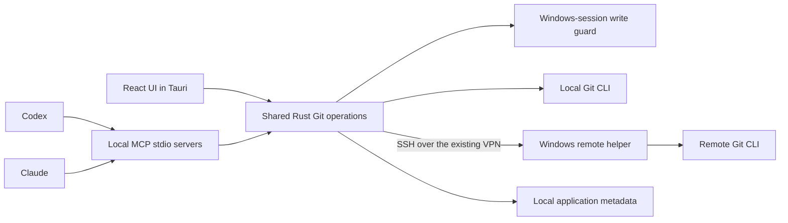

# Enogram Roadmap

Updated: 2026-11-10
Status: Local file/hunk/line stage/unstage and prepared-index commit, branch create/switch, remote address management, explicit fetch/fast-forward pull/push, branch graph, appearance controls, Windows process-tree supervision, and a local MCP read/write increment implemented. Live remote Windows checkout management and the full application-owned MCP bridge remain deferred.

Product: A personal, open-source desktop Git client that the owner can understand, maintain, and extend as needs arise.

Public-source preparation (2026-11-10): MIT licensing, anonymous `example` documentation and screenshots, and a self-contained animated README. The public repository starts from a sanitized snapshot; the historical acceptance records below describe the privately retained development history, not the public commit graph. No public installer release is claimed.

This roadmap records Enogram's technology, platform, remote-access, and MCP direction. Optional ideas remain proposals unless included in a milestone below.

## 1. Confirmed direction

| Area | Confirmed choice | Consequence |
| --- | --- | --- |
| Product name | Enogram | Use Enogram in the application, packages, and documentation. |
| Purpose | A Git client the owner can modify for personal needs | Prefer understandable modules and working daily workflows; prioritize improvements from actual use. |
| Desktop shell and UI | Tauri + React | Build one desktop application with a Rust core and a React presentation layer. |
| Git implementation | Rust core calling Git CLI, as established in the project plan | Git remains the source of truth for repository state. |
| First desktop platform | Windows | macOS and Linux follow later, with their own validation. |
| Remote working computer | Windows | Implement and test Windows-to-Windows execution first. |
| VPN access | Both Git-server access and management of an existing remote checkout | Support ordinary clone/fetch/push and live remote status, index, commits, and worktrees. |
| MCP clients | Codex and Claude | Both must be able to read repository state and perform stage/commit operations. |
| Visual direction | The supplied dense desktop reference, with selectable liquid-glass themes | Preserve the repo tree, commit graph, change list, and large diff panel; offer light/dark palettes, button styles, and a color generator. |
| Core Git experience | Visual history/diff, worktrees, and GUI conflict resolution | Include these in the first complete personal release. |
| Source availability | Open source under MIT | Preserve the project license and the separate notices of third-party dependencies. |

The first complete release includes local and remote Windows workflows and MCP writes for both clients. Earlier milestones are usable increments, not a claim that the entire requested product is finished.

## 2. Technical defaults proposed for implementation

These are reasoned implementation proposals, not additional user-confirmed requirements. Validate them in M0 and record any change here before adopting a dependency or changing a public contract.

| Topic | Proposed default | Reason and validation |
| --- | --- | --- |
| Frontend | React + TypeScript + Vite | Keep UI contracts explicit and use a straightforward desktop SPA build. Tauri documents Vite integration for React and other SPA frameworks. [Tauri frontend guidance](https://v2.tauri.app/start/frontend/) |
| Core | Rust modules for application operations, Git parsing/execution, and adapters | Keep Git rules independent of React, Tauri commands, and MCP transport. |
| Local metadata | SQLite accessed through the Rust core | Suitable for operation records, review records, and preferences. Git objects and the index remain authoritative. [SQLite desktop use](https://sqlite.org/whentouse.html) |
| Git distribution | Use a detected, explicitly selected system Git initially | Preserve the user's credential/signing setup; establish a tested minimum version before promising support. Bundling Git is a separate packaging decision. |
| MCP transport | Local stdio server reusing the Rust Git core | The initial increment uses explicit startup repository/write grants and coordinates updated processes through a Windows-session mutation guard. An application-owned IPC bridge remains a later architectural step. [Codex MCP](https://learn.chatgpt.com/docs/extend/mcp?surface=cli), [Claude Code MCP](https://code.claude.com/docs/en/mcp) |
| MCP implementation | Bounded adapter pinned to legacy MCP `2025-11-25`, using existing JSON dependencies | Keep the initial tool surface small and verify it with actual clients. This replaces the proposed SDK for this increment; newer protocol revisions and optional MCP capabilities are not claimed. [MCP lifecycle](https://modelcontextprotocol.io/specification/2025-11-25/basic/lifecycle) |
| Local coordination | Non-inherited Windows-session mutex shared by updated desktop and MCP writers | Return Busy on contention; inspect after interruption before another write. External Git, older binaries, and other Windows sessions remain outside this guard. Named-pipe registration and live GUI grants remain planned. |
| Remote execution | Windows OpenSSH plus a small versioned Rust helper | Run Git beside the remote files; transfer structured requests/results rather than concatenate arbitrary shell commands. Windows SSH can start different default shells, which affects helper bootstrap. [Microsoft OpenSSH configuration](https://learn.microsoft.com/en-us/windows-server/administration/openssh/openssh-server-configuration) |
| Process lifetime | Each client owns its stdio MCP process; desktop is optional | No background service or HTTP listener is required. Closing a client is not rollback; reconcile possible writes after an interrupted connection. |
| Diff and graph UI | Evaluate an existing text editor component; use virtualized history rows and a Git-derived graph | Choose the editor and rendering details with the reference layout and large-diff fixture, not a visual-only demo. Git-produced hunks remain authoritative for staging. |
| First support target | Windows 11 x64 as the proposed reference environment | Confirm the actual local and remote Windows versions in M0. Windows 10, ARM64, and Server editions require explicit validation. |
| UI language | Turkish labels with familiar Git terms such as Commit, Stage, Stash, and Worktree | Match the reference and conversation while avoiding ambiguous translations. Keep text separable for later localization. |

No additional database server or hosted account system is needed for the planned local workflows. Secrets belong in appropriate OS-protected storage, not ordinary preference records.

### Shared execution model

The diagram shows responsibilities, not a requirement for a separate package for every box. Start with a modular application. Extract shared crates where the desktop, bridge, and remote helper actually reuse code.

One coordinator owns application-originated mutations for a worktree. Operations that affect shared refs also coordinate at repository level. External editors, terminals, and agents remain independent writers: re-read relevant state before mutation and verify the observed result afterward.

Use explicit environment, repository, worktree, operation, and snapshot identities. A mutating request must never derive its target from whichever GUI tab happens to be selected.

## 3. Workspace layout and implementation direction

The layout keeps repository navigation, commit history, changed files, and a persistent diff pane together. Public screenshots use a disposable repository named `example`; private design references are not distributed.

### What works

- A repository/worktree tree makes navigation visible without hiding it behind separate pages.
- Commit rows and graph lanes are aligned, making history easier to follow.
- A large, persistent diff area supports continuous review.
- Git actions, connection state, and the commit composer are available in one workspace.
- The dark, compact desktop style suits a tool kept open alongside an editor.

### Screen steps and improvements

These are the intended steps inferred from the reference, not interactions performed against a live app.

| Step | Visible area and assessment | Enogram direction |
| --- | --- | --- |
| 1. Choose a target | Toolbar and sidebar provide useful context, but repeat repository/branch information and mix several navigation concepts. | Keep host → repository → worktree → branch context unmistakable. Give the SSH working environment and Git remotes distinct labels. Show the full Windows path on demand. |
| 2. Inspect history or current work | The graph and diff are strong anchors. A selected historical commit and a working-change list appear together, so the diff's source needs a stronger label. | Separate Working Changes and History modes. A diff header always names its source: working tree vs index, index vs HEAD, or commit A vs commit B. Preserve selection by identity when data refreshes. |
| 3. Stage and commit | Checkboxes, staged counts, and a combined stage/commit action leave room for selection and staging to be confused. | Separate row selection from stage state; represent partially staged files. Use an explicit Commit button showing the staged file count. Any combined stage-and-commit action previews its exact scope. |
| 4. Inspect activity and MCP | Connection indicators are visible. A generic write-enabled badge does not describe what each client may do; the lower panel competes with diff space. | Show Codex and Claude separately, with target scope and read/stage/commit grants. Put activity, local review notes, and MCP details in a collapsible lower drawer. |

### Visual and interaction specification

1. Preserve the three-column structure. Start with a roughly 240–280 px navigation pane and adjustable history/diff widths. Save split positions per layout, within sensible minimum sizes.
2. Use a restrained graphite/navy surface, a clear blue selection accent, lighter separators, and less saturated diff backgrounds. Reserve green/red for meaningful change states and pair them with symbols/text.
3. Use readable UI and code typography with adjustable size and density. Avoid fitting more information by shrinking every label.
4. Replace ambiguous labels such as “Taahhüt” and “Dizin” with recognizable Git actions and explicit working/index descriptions. Use Windows Ctrl shortcuts and Windows paths in actual product examples.
5. Give the selected diff, active worktree, and in-progress operation clear visual priority. Keep unrelated actions from competing with the primary task.
6. Provide inline and side-by-side diff modes, search within the diff, hunk navigation, and an expandable result editor for conflicts.
7. At 1366 × 768 or high scaling, allow the sidebar/drawer to collapse and the diff to take focus. At the reference size and 1920 × 1080, retain the dense overview.
8. Design empty, loading, stale, offline, unsupported, failed, cancelled, and uncertain-result states alongside the successful state.

Team comments and avatars in the reference do not require a collaboration backend. Local notes and operation activity can occupy that area first; shared review/PR integration is a later option.

Accessibility and behavior still require implementation checks: actual color contrast, keyboard traversal, focus visibility, screen-reader labels, splitter operation, text scaling, and scroll stability cannot be certified from this screenshot.

## 4. Milestones and release boundaries

The current implementation package covers the Git-derived branch graph, desktop file/hunk/line stage/unstage and prepared-index commit, local branch create/switch, remote address management, explicit Git remote operations, and local MCP tools. MCP stage/unstage still operates on whole files. This covers parts of M1, M2, and M3. Remote Windows host testing was deferred by the owner. MCP acceptance distinguishes Codex, Claude Code, and Claude Desktop, and the full M3 application-owned bridge remains a separate boundary. The remaining milestones are planned; M0 is not considered fully passed while its feasibility checks are outstanding.

| Milestone | User-visible result | Main exit condition | Dependency |
| --- | --- | --- | --- |
| M0 — Foundations and feasibility | A concrete screen/interaction specification and proof that Windows, SSH, and the two MCP clients can use the proposed architecture | Small local, remote-read, and client-connection probes succeed; unresolved capabilities are documented | Current roadmap |
| M1 — Local visual reader | Open a repo and navigate real status, worktrees, history, and diffs in the reference-style layout | Displayed identities/content match independent Git queries; stale responses never populate a different selection | M0 core/UI baseline |
| M2 — Daily local Git | Stage/unstage, commit, branch, clone/fetch/pull/push, and basic stash | Only intended content changes; errors/cancellation and operation results are accurately reported | M1 |
| M3 — Codex and Claude writes | Both clients read, stage, and commit through Enogram locally | Both clients pass real integration tests, including shared-worktree concurrency and stale requests | M2 shared mutation service |
| M4 — Worktrees and conflict resolution | Create/manage worktrees and resolve supported merge/rebase/cherry-pick conflicts visually | Correct target/index state, distinct save/stage/continue actions, and verified recovery boundaries | M2; M3 coverage remains valid |
| M5 — Remote Windows parity | Operate an existing remote Windows checkout over VPN/SSH, including from both MCP clients | No local reclone required; declared remote workflows pass, including connection-loss reconciliation | M0 remote probe and M2–M4 operations |
| M6 — First complete personal release | An installable Windows application delivering the agreed local, remote, GUI, and MCP scope | Integrated acceptance matrix and clean-machine packaging checks pass | M1–M5 |

Daily local use can begin after M2. Local agent-assisted use can begin after M3. The full requested Windows scope is complete only after M6, including remote operation and both MCP clients' stage/commit capability.

Calendar estimates should be set after M0 establishes the actual build, remote host, and client constraints. No duration or performance claim below is a measured result yet.

### M0 — Foundations and feasibility

Deliverables:

- Confirm local/remote Windows versions, exact Codex and Claude application editions, Git versions, and the intended OpenSSH authentication path.
- Establish the dependency choices and supported minimums; validate a packaged Tauri window on the first Windows target.
- Specify Working Changes, History, conflict resolution, and the MCP/activity drawer using the supplied visual direction. Include narrow/high-DPI layouts.
- Define typed reads/mutations, snapshot identities, operation outcomes, and the shared operation-owner lifecycle.
- Prove a local status/diff read, Windows SSH helper launch plus remote status read, and connection from each target MCP client. The remote probe uses a disposable test repo when host access becomes available.
- Create a small repeatable Git fixture set: partially staged file, linked worktree, rename, text conflict, external edit, and large history/diff.

Exit: a buildable minimal path, documented support assumptions, and successful high-risk probes. If remote host/client access is unavailable, record that probe as pending and continue independent local work; do not declare M0 entirely passed.

### M1 — Local visual reader

Deliverables:

- Repository open/recent list, linked-worktree discovery, branch/tag/remote navigation, and operation-state display.
- Paged commit graph with stable rows and selection; history search/filter and selected commit details.
- Separate staged, unstaged, untracked, and conflicted views. Read-only inline/side-by-side diff and clear scope headers.
- Background refresh driven by filesystem hints plus authoritative Git reads. Bound output, cancel obsolete work, and ignore late results.
- Resizable panels, keyboard navigation, appropriate empty/error/loading states, and initial layout/performance measurements.

Exit: status, diff, and worktree identity match Git; switching A → B while A is loading never displays A under B; shrinking a list preserves a valid selection/scroll position. Large data does not require loading all history or every diff into the UI.

### M2 — Daily local Git

Deliverables:

- File and hunk stage/unstage, preserving mixed staged/unstaged content. Line staging follows its own correctness check.
- Commit composer using the current prepared index; signing and hook failures are visible. Branch create/switch/rename and guarded delete.
- Clone, fetch, explicitly chosen pull behavior, upstream setup, and ordinary push. Verify VPN Git-server access here, independently of live SSH checkout management.
- Basic stash create/inspect/apply and guarded drop; operation history and bounded recovery support for the implemented risky operations.
- Structured outcomes: completed, partial, no change, rejected, failed, cancellation requested, and result uncertain where appropriate.

Exit: real-repo tests verify expected index/tree/ref results and preservation of unrelated work. Old previews fail when their relevant inputs change. Hooks that change content cannot leave the UI claiming a different reviewed tree was committed. Credential/signing prompts terminate with an intelligible outcome.

### M3 — Codex and Claude read/stage/commit

The initial local increment exposes seven stdio tools through the existing Git core, with startup repository/write restrictions, snapshot tokens, bounded per-process operation replay, and a shared Windows-session write guard. It runs without the desktop application. The deliverables below describe the broader milestone, including UI registrations and durable reconciliation; they are not all implemented by this increment. See [local MCP setup](docs/MCP.md).

Deliverables:

- A local MCP stdio bridge connected to the running Enogram operation owner, with a compatibility-tested protocol version.
- Both clients can inspect status, history, diffs, worktrees, conflicts, and operation results for explicitly registered targets.
- Both clients can stage selected files/hunks and commit a prepared index. They share the GUI's validation, queue, logging, and result verification.
- Per-registration grants for environment/repository/worktree and read/stage/commit. Revocation and client disconnect are visible in the UI.
- A preparation step binds writes to a concrete target, intended paths/hunks or index tree, expected state, and operation ID. Repeated requests resolve to the existing operation rather than blindly apply again.
- Reuse the user's scope grant for ordinary calls within it. Request a new decision only when scope/policy requires it; do not turn every already-authorized action into a fresh modal prompt.

Exit: real Codex and Claude integrations each pass read → stage → commit locally. Test GUI/client and client/client contention, changed index after preparation, wrong worktree, revoked access, duplicate requests, bridge termination, and application restart. A client's display name alone must not grant access.

Initial MCP write scope is stage/commit. Push, destructive cleanup, arbitrary shell commands, and history rewriting require separate future scope decisions. GUI Git functionality is a separate capability surface governed by the same core checks.

### M4 — Worktrees, conflicts, and recovery

Deliverables:

- Worktree create/open/remove with dirty/untracked content inspection, explicit branch handling, and non-blocking progress.
- Merge preview tied to source/target commits; clear identification of excluded working changes and possible object-store effects.
- Conflict editor showing base, the actual named sources, and an editable result. Support text/text, add/add, and modify/delete first.
- Correct merge/rebase/cherry-pick continue/abort flows and detection of operations started outside Enogram.
- Recovery preview for the data actually captured. Restore into a separate recovery branch/worktree where practical, preserving later external edits.

Exit: save, stage, and continue are distinct verified transitions. Unsupported binary/rename/submodule cases explain the limitation and offer a safe alternative. Worktree removal never silently becomes branch deletion. Interrupted cleanup reports completed and remaining steps.

### M5 — Live remote Windows checkout

Deliverables:

- Host selection, host-key verification, remote Git/helper capability check, and existing Windows repo/worktree selection without recloning.
- A versioned helper in a user-writable location, with a known installation/removal path and compatibility handshake. Installation is an explicit operational step, not implied by opening a repository.
- Structured SSH communication; safe handling of drive letters, spaces, Turkish/Unicode paths, long paths, case behavior, and cmd/PowerShell bootstrap differences.
- Status/diff/history, stage/unstage/commit, applicable branch/network operations, worktree lifecycle, and supported conflict-resolution flows on the remote machine.
- Both MCP clients use the same remote target identities and declared stage/commit capability as the GUI.
- Local and remote operation records support reconnect/reconciliation. A lost response does not trigger a second commit or push automatically.
- Remote file/content caching has explicit bounds. SSH login, the remote machine's Git-hosting credentials, and commit signing are separate contexts.

Exit: all declared remote workflows are tested against a real Windows SSH target. Inject disconnects before, during, and after mutations; reconcile actual refs/index/content, or retain an honest uncertain result. Test 20/80/200 ms RTT where practical. Helper startup failure, version mismatch, host-key change, denied access, and a locked file produce accurate errors.

Existing VPN/OpenSSH access is a prerequisite. This roadmap does not provision VPN, firewall rules, SSH services, or credentials automatically. A helper or transport change must not create a second, looser Git execution path.

### M6 — Packaging and integrated acceptance

Deliverables:

- Windows package containing the desktop and local bridge, plus a compatible remote-helper distribution and recovery path for version mismatch.
- Clean install, launch, update, and uninstall checks; WebView/runtime/Git prerequisites clearly diagnosed.
- End-to-end local and remote journeys through the GUI and both actual MCP clients; fixed library/protocol versions documented.
- Keyboard, screen-reader, contrast, text-size, and 100/125/150/200% scaling checks. Verify the reference layout and compact mode on actual Windows rendering.
- Personal-use guide, architecture/module map, adding-a-Git-operation guide, known limitations, and backup/recovery scope.
- License/dependency review before public source release. Signing and public auto-update policy are decided before public installer distribution; do not present an unsigned personal build as a signed public release.

Exit: the integrated matrix below passes and unresolved critical data-loss/security defects block release. Public promotion is separate from reaching a usable personal build.

## 5. Acceptance matrix

| ID | Required evidence | First gate |
| --- | --- | --- |
| A01 Target and read accuracy | Same-named local/remote repos and linked worktrees remain distinct; status/history/diff agree with Git | M1; repeat against remote adapter in M5 |
| A02 Review context | Late responses, refreshed lists, and switching history/current-work views never display a diff under the wrong identity | M1 |
| A03 Stage and commit accuracy | Selected hunks only; unrelated staged/unstaged content survives; final commit tree is verified, including hook behavior | M2 |
| A04 Daily Git and VPN | Branch, fetch/pull/push, clone, and stash produce verified outcomes and distinguish network/auth/conflict errors | M2 |
| A05 Both clients, local | Codex and Claude each read, stage, and commit; target grants and stale-state checks are enforced | M3 |
| A06 Concurrent writers | GUI plus two clients coordinate; external changes invalidate relevant preparations without being overwritten | M2/M3 |
| A07 Conflicts and worktrees | Supported conflict types, continue/abort, independent indexes, and cleanup behavior match Git | M4 |
| A08 Both clients, remote | Codex and Claude each read, stage, and commit an existing remote Windows checkout; GUI reflects those results | M5 |
| A09 Interrupted operations | Repeated IDs, dropped connections, cancellation, crashes, and signing/hook failures never become invented success or blind re-execution | M2/M3/M5 |
| A10 Recovery and boundaries | Captured data can be recovered within its stated scope; later edits survive; unsupported features and missing prerequisites are visible | M4/M6 |
| A11 UI and distribution | Reference/compact layouts, accessibility checks, responsiveness, install/update/uninstall, and dependency/version compatibility | M1 baseline, M6 integrated gate |

Use parser tests plus integration tests against disposable real repositories; mocks alone do not prove Git correctness. Every new adapter needs contract verification. Run focused checks during each milestone, then one integrated verification for the complete release candidate; repeat only failures or checks affected by subsequent changes.

Initial measurement targets inherited from the research plan: cold interactive launch ≤3 s p95; warm first useful status/graph page ≤1.5 s p95 on the reference medium repo; already-loaded UI response ≤100 ms p95; ordinary text diff rendering ≤500 ms p95 after data arrival. Set hardware, data, and measurement boundaries in M0. Treat the proposed 400 MB total app/WebView memory budget as something to measure and refine, not a promised result.

For this personal project, acceptance is based on the owner's real tasks plus reproducible fixtures. A multi-person market/usability study is not a prerequisite to implementation.

## 6. Later extensions

Prioritize these from actual use after the agreed Windows baseline:

- File-level “changed since my review,” then hunk-level review records with explicit invalidation.
- Merge decision notes and remerge-diff with clear comparison semantics.
- Persistent interactive rebase plans, advanced rewrite/reflog flows, and explicit force-with-lease operations.
- Testing a frozen staged snapshot or two selected branches in a temporary workspace; test execution and isolation require a separate design.
- Broader LFS/submodule support, image/binary diff, sparse/partial clone, and very large monorepo workflows.
- PR/provider integration, shared comments, optional AI suggestions, and worktree overlap analysis.
- Local/remote work transfer preserving staged/unstaged distinctions.
- macOS/Linux desktop support; other remote operating systems and WSL only when separately selected and validated.

### November 9 feature comparison and immediate priorities

The comparison uses current official product documentation and Enogram's source inventory. These priorities are choices for this personal tool, not a claim of user interviews or market validation.

| Need | Evidence and comparison | Enogram decision |
| --- | --- | --- |
| Find a recent commit quickly | GitKraken documents message/SHA/author search and the loaded-graph depth limit. [Search guide](https://help.gitkraken.com/gitkraken-desktop/search/) | Add matching and navigation over the loaded history without removing graph rows. Clearly limit scope to the currently loaded maximum of 80 commits. Repository-wide search and pagination are next. |
| Fit more useful content and retain layout | GitKraken supports configurable graph columns and saves their widths/order. [Interface guide](https://help.gitkraken.com/gitkraken-desktop/interface/) | Add compact/comfortable density and persistent pane widths/sidebar state. Keep preferred widths separate from temporary viewport constraints. |
| Find files in larger changesets | GitKraken documents filename/extension filtering in its all-files view. [File guide](https://help.gitkraken.com/gitkraken-desktop/adding-and-removing/) | Adapt this discovery pattern to changed and commit files: path search, working/staged/conflict filters, honest empty states, and explicitly visible-only bulk staging. This adaptation is our product decision. |
| Navigate existing worktrees | GitKraken exposes worktree opening from its repository interface. [Worktree guide](https://help.gitkraken.com/gitkraken-desktop/worktrees/) | Make existing non-bare worktree entries keyboard/click targets using the existing guarded open flow. Creation/removal and aggregated status remain separate. |
| Review large diffs and prepare focused commits | GitKraken documents hunk navigation and inline/split views; Fork lists line-by-line staging. [Diff guide](https://help.gitkraken.com/gitkraken-desktop/diff/), [Fork features](https://fork.dev/) | Next read-only increment: text search, previous/next hunk, wrapping. Then design and verify hunk/line staging in the shared Rust core. Stash, clone, guarded branch deletion, and conflict resolution retain their roadmap scopes. |

The immediate UI work also repairs two demonstrated defects: inert collapsed-sidebar buttons and panel-width preferences overwritten during window resizing. It adds no Git commands or MCP tools. GUI file filtering does not grant repository access to MCP clients or change commit semantics.

## 7. Current evidence and next implementation package

The project folder contained no implementation when this roadmap was prepared. Initial checks found Git 2.41.0.windows.1, rustc/cargo 1.99.0, Node 24.18.0, and a Codex CLI with stdio/HTTP MCP configuration support. The Tauri desktop has since built and run on this Windows machine. Claude CLI was not found on the planning shell's PATH; that does not establish whether Claude Desktop or another Claude installation exists. Remote host access and runtime capabilities remain untested.

The reference image has been inspected and preserved unchanged. Its example repositories and identities do not imply an integration with other projects.

The initial local Tauri/React/Rust preview now builds on this Windows machine. It opens Enogram itself and reads real status, worktrees, recent commit history, and text/binary diff results. The core's eight repository tests and the diff parser's eight scoped cases passed. Desktop checks exercised working/staged diff separation, refresh, root and later commit selection, repeated selection, binary handling, invalid-path recovery, and a 1000×650 layout. These are initial functional checks, not full M1 acceptance.

The current increment implements explicit stage/unstage/commit commands and a real parent-linked graph. Focused tests cover literal paths, unborn and partial staging, renames/deletions, state tokens, conflict/lock failures, hooks/signing, changed HEAD after commit, all-ref history, first-parent merge diffs, and merges whose tree equals HEAD. Graph tests cover actual parent edges, independent heads, merges, octopus parents, and missing-parent continuation. These checks do not complete the broader M1/M2 milestones.

Desktop acceptance uses Enogram itself. The initial implementation commit was created through the UI. Unborn stage/unstage preserved file bytes; an externally changed index rejected the old commit request and preserved its draft; double submission produced one commit; a newer unstaged edit stayed out of that commit. Documentation commits on separate branches provide meaningful project history for visual branch/merge checks.

The appearance increment adds Graphite, Aurora, Glacier, and Ember presets, a seed-color palette generator, four button styles, and saved surface/blur/opacity preferences. Semantic text, diff, selection, and graph colors follow the active palette; diff content stays opaque for readability.

On Windows, the Git runner now assigns the process to a private Job Object atomically at creation and polls bounded, nonblocking pipe operations against one deadline. It terminates remaining command descendants on completion or failure, including helpers holding inherited output pipes. Hooks and filters retain their configured semantics, but must complete command-scoped work before returning. Timeout is not rollback; mutation errors still require a refreshed state and are never automatically retried. Non-Windows descendant supervision remains a separate platform task.

Verification for this increment: 33 substantive core checks passed, with one subprocess entry intentionally ignored; the theme suite's nine checks and the graph suite's eleven checks passed. The actual Tauri window exercised four presets, all button variants, custom color validation, saved preferences, Escape/focus restoration, and a loaded 1000×650 workspace. A temporary clean filter in Enogram's own checkout exceeded the 20-second deadline during a read-only diff: the UI returned an error, both observed Python processes exited, and the index stayed byte-identical with no lock file. The temporary filter, attributes, and file marker were restored afterward. These checks establish the local Windows increment, not full cross-platform or release acceptance.

The branch/network increment adds branch create/switch and Fetch/Pull/Push target forms. Branch switches use Git's protections for working files and other worktrees. Network operations bind the displayed checkout and effective remote configuration, fetch into remote-tracking heads, pull only by fast-forward, and push one captured commit to one explicit branch without force. Local bare repositories supply reproducible acceptance targets; this does not establish real SSH/HTTPS credential or VPN connectivity.

Integrated core verification passed 66 tests, with one subprocess fixture entry intentionally ignored. The new operation model's six checks and the existing four working-change checks passed. Focused cases include dangling symbolic references, local edits and ignored files, other-worktree occupancy, remote configuration drift, non-fast-forward rejection, hook side effects, signature-verification requirements, and credential-safe display of malformed URLs.

The remote editor adds named remotes and changes their configured Fetch/Push addresses without starting a network operation. Existing names and tracking/upstream settings stay intact. Editing binds the opening configuration token and distinguishes configured input from resolved, redacted display addresses. Unsupported inherited or complex configurations remain visible with an explanation.

Remote-editor verification passed 78 integrated core tests (one subprocess fixture entry intentionally ignored), 14 operation-model tests, four working-change tests, and the native desktop build. Independent API probes covered real global scope, URL rewrites, hidden originals, included files, and transaction cleanup. In Enogram's actual Windows window, adding a nonexistent local destination succeeded without contact; editing a separate Push URL sent commits only to that target; clearing it restored Fetch-address inheritance. Invalid/duplicate names, stale external edits, preserved hidden originals, cancel/reopen drafts, modal shortcuts/focus, and 1000×650 dark/light layouts passed. HEAD, index bytes, and unrelated local configuration remained unchanged during settings acceptance, and the temporary remote was removed afterward. Live SSH/HTTPS authentication remains unverified.

The six audit fixes retain session commit drafts per canonical worktree, preserve history file selection on refresh, keep active W/S re-clicks from invalidating a pending diff, reconcile Windows worktree path spellings, and accept linked worktrees backed by a bare root. Successful commits compare the prepared index and committed tree through read-only canonical tree deltas; changed contents produce a warning with the actual commit ID while preserving configured hooks and signing.

Verification passed 53 integrated Node checks and the native desktop build. The full Rust run passed 82 tests, failed one unchanged process-runner fixture at its 1.2-second deadline, and intentionally ignored one subprocess entry. That exact failed fixture passed once in isolation in 0.06 seconds, without source or threshold changes. At that checkpoint the cause was unresolved and the integrated Rust run was not recorded as fully passing; the follow-up investigation is recorded below. The 13 focused core checks for this increment passed separately.

In the actual Tauri window, Enogram's checkout retained drafts across repository aliases, failed opens, and a second worktree, preserved the selected history file on refresh, and completed both W/S reads after real backend responses were deliberately held during an active-layer re-click. A bare clone of Enogram supplied the linked-worktree and successful modifying-hook cases: the hook ran once, the created commit contained both the prepared file and hook addition, and the UI displayed its real OID with a warning. The warning also fit a 1000×650 WebView viewport without horizontal overflow. These checks do not establish native installer or remote Windows acceptance.

The process-test follow-up reproduced a matching timeout by forcing an unrelated test sleeper to start while the supervisor's temporary inheritable pipe handles existed. Windows handle-object comparisons proved that the old `std::Command` launch received the same stdout/stderr endpoints. The root process had exited after about 121 ms, but the unrelated sleeper kept the pipes open and the supervisor timed out after about 1,204 ms. Without that peer the case passed; with handle inheritance disabled, the same overlap completed after about 68 ms while the unrelated process remained alive. The historical failure log did not contain phase timings, so these measurements describe the controlled reproduction rather than reconstructing the original run.

The fix launches only the unrelated test fixture with `CreateProcessW` handle inheritance disabled. An invocation-local test probe forces the overlap in a regression that checks handle identity, normal completion, exact root/helper termination, absence of delayed writes, and survival of the unrelated process. The 1.2-second deadline, assertions, and production Git supervision remain unchanged. This prevents the demonstrated fixture interference; it does not claim to constrain arbitrary third-party broad-inheritance launches inside the same process.

Follow-up verification passed all 10 scoped process tests and the full default-parallel Rust run: 84 passed, zero failed, one intentionally ignored subprocess entry, in 259.93 seconds. `cargo check -p enogram-desktop` also passed. The failed reproduction, controls, and instrumented source snapshots remain in ignored diagnostic artifacts. Native UI acceptance could not be completed in this session because Windows accessibility/screen capture did not provide a usable Enogram view; no new UI behavior is claimed.

The subsequent native UI acceptance exercised Enogram's own checkout through visible Stage, Unstage, S/W, and Commit controls. A staged README change and a later working edit appeared in separate layers; unstage preserved the exact working bytes, and commit cleared the draft. Commit `1e5b43754d6680bb8fe22aa35bd2549d981d3cbf` matched all 56 prepared index entries, appeared in history with its correct parent, and left a clean checkout. This closes the earlier session's UI verification gap for that local workflow.

The local MCP increment uses the same snapshot, diff, stage, unstage, and commit functions as the GUI. Startup grants restrict calls to registered canonical checkout roots. The protocol adapter bounds requests, responses, and operation replay; read-only grants are enforced at execution, and Git errors use controlled messages instead of raw hook diagnostics. Shared Windows writes fail fast on contention and require a fresh inspection after an observed abandoned owner. The server pins a tested legacy protocol rather than claiming the newer stateless revision.

Integrated verification passed 86 core checks (two subprocess entry points intentionally ignored), five MCP protocol/cache checks, one compiled-binary stdio check, and seven MCP Git workflows. The frontend and native desktop builds passed. Actual Codex CLI and Claude Code processes each listed the authorized Enogram checkout, inspected its HEAD/status/token, and read its README diff through MCP. Repository redirection tests include `core.worktree`, `.git` pointers, and linked-worktree shared metadata; write fixtures cover stale tokens, unstage preservation, prepared-index commits, hook failure, and duplicate operation results. Claude Desktop configuration is registered separately; its live chat acceptance requires a usable application session.

The November 9 audit fixes distinguish binary metadata from ordinary patch text, preserve numbering/highlighting with suppressed blank context lines, retain remote-address drafts after both save and refresh fail, and align the diff footer count with rendered rows. Integrated verification passed 88 core checks (two subprocess entry points intentionally ignored), 13 MCP checks, and 63 frontend checks; frontend and native desktop builds passed. The new MCP binary read Enogram's original Rust-file commit as text. In the actual Tauri window, that commit displayed 2,792 rows with a matching footer. Controlled renderer responses from Enogram's real Git diff verified suppressed blank context; controlled save/refresh errors verified remote draft retention without a Git configuration write. Existing MCP processes keep their loaded binary until their connection is restarted with the updated build. Installer packaging remains a separate next step.

The November 9 installer increment produces a per-user Windows x64 NSIS package through `npm run installer:build`. It builds the current desktop and MCP releases in an isolated target directory and includes the standalone MCP executable and setup documentation. MCP uses a static MSVC runtime; package creation preserves development executables and client settings. The desktop opens with a repository picker on first use and remembers only a successfully opened canonical path. Installer and uninstaller checks reject busy installed executables without terminating the desktop or client-owned MCP processes.

Installer verification passed 69 integrated frontend checks, the release desktop/MCP builds, and NSIS packaging. The installed MCP read Enogram's own history and staged/unstaged the new installation guide while preserving working bytes, HEAD, refs, and index entries. Native installed-window checks covered first use, saved-path restoration, and recovery from an unavailable saved repository. Fresh installation, closed-app same-version update, uninstall, and reinstall passed; active MCP/desktop checks returned a failure without changing binaries or stopping existing processes. Installed MCP hashes matched the release and staged sidecar. The desktop differed from the standalone release only by Tauri's documented NSIS bundle marker. This unsigned personal package was tested on the existing Windows development machine; clean-machine acceptance and the missing-WebView2 download path remain unverified. Claude Desktop live chat acceptance remains separate.

The November 9 compact-workspace increment adds compact/comfortable density, persistent preferred panel widths and sidebar state, file/path and status filters, loaded-history matching, and navigation to existing worktrees. Search preserves every loaded graph row and parent edge. Filtered bulk stage/unstage acts only on visible eligible files; committing still uses the entire prepared index and blocks conflicts across the repository. Collapsed-sidebar controls now work. A native check also exposed overlapping toolbar labels at the minimum viewport; the responsive controls now use consistent icon-only widths.

Verification passed 82 integrated frontend checks and the current desktop/MCP release and NSIS builds. Native Tauri checks measured 36px history / 28px file rows in compact mode and 50px / 34px in comfortable mode, verified graph alignment, restored preferred widths after narrowing, and preserved settings on reload. Both densities' toolbar targets and dark/light glass themes passed at a 1000×650 WebView viewport. A controlled preference-storage failure kept a visible explanation at that size and cleared after saving recovered. Enogram's own checkout exercised filtered stage/unstage of one new source file, preserving its working bytes, HEAD, refs, and all index entries. Search kept all 14 loaded commits and their parent edges; collapsed controls and worktree navigation with separate drafts passed. Worktree navigation used two detached worktrees from a local bare clone of Enogram. These checks do not establish native outer-window resizing, clean-machine installation, or Claude Desktop live chat acceptance; the refreshed installer was built but not installed in this increment.

The next November 9 increment adds repository-wide history search and diff navigation. Search reads all locally reachable refs plus detached HEAD in bounded batches, matches full commit messages, author/email, SHA and ref names literally, and provides progress, stop/resume, and result pages. A history token binds continuation to the checkout and its refs/HEAD and shallow/graft boundaries. Results are separate from the recent graph; an older selected commit retains its real metadata and file selection across refresh. Diff search highlights displayed text, navigates occurrences and hunks, isolates keyboard shortcuts, and resets when the target changes. Truncated output and the 2,000-highlight limit remain explicit. No new Git writes or MCP tools are added.

Verification for history/diff search passed 102 integrated frontend checks, then 12 focused DiffView component checks after a native scrolling defect was fixed. The Rust run passed 97 core checks (two subprocess entry points intentionally ignored) and 13 MCP checks. The initial default-target run could not replace the MCP binary held by an existing client; the successful run used a separate target directory without stopping client processes. Desktop/MCP release builds and NSIS packaging passed.

Native acceptance searched Enogram's own 14-commit history and exercised literal/SHA queries, root metadata, result navigation, diff matching and hunk navigation, keyboard/modal ownership, and target resets. A separate Enogram clone with 142 commits verified selection beyond the recent 80, preservation across refresh, and complete 100/28 result pages without duplicate OIDs. Another file in that fixture verified the visible 2,000-highlight limit and last retained match. The first small-panel check exposed scrollIntoView moving the surrounding pane; navigation now scrolls only the code viewport. The rebuilt application passed 1000×650 WebView / 320px diff-pane checks in dark and light glass and forced-colors checks. HEAD, refs, and index entries in the original checkout remained unchanged. Native outer-window resizing, installation of this refreshed package, missing-object partial clones on newer Git, and Claude Desktop live chat remain outside this acceptance.

The November 9 partial-staging increment adds desktop changed-line checkboxes, aggregate hunk selection, direct hunk Stage/Unstage, and selections spanning multiple hunks. The Rust core supplies canonical diff line IDs and a token covering the patch, snapshot, selected layer/path, and complete working-file bytes. It reconstructs selected content itself, applies only to a private index while holding Git's index lock, then publishes that index once. Unsupported representations retain diff viewing without a write token. Unsafe EOF subsets are rejected instead of joining lines. Whole-file actions and the MCP tools keep their existing scope.

Verification passed 117 integrated frontend checks, 113 core checks (two subprocess fixture entries intentionally ignored), 13 MCP checks, and the desktop/MCP release and NSIS builds. The initial scoped fixtures exposed untracked-status-column selection and Windows verbatim-path handling for the alternate index; both were fixed without weakening assertions. The 16 new Git cases cover replacement/inverse selection, independent hunks, unborn/new/deleted/empty files, CRLF and exact raw-byte drift, Unicode/literal paths, missing final newlines, stale inputs, foreign locks, failed private application, split-index preservation, and unsupported metadata/large output. Independent source review found no remaining concrete defect in this increment.

Native Tauri acceptance used controlled comments in Enogram's own `.gitignore`. Line staging, hunk staging while retaining an already staged line, inverse hunk/line operations, and selections across hunks produced the exact expected index blobs. External working-file drift rejected the old selection and refreshed the view while retaining the draft. The original working bytes, full index-entry manifest, HEAD, branch and branch/remote/tag refs were restored or preserved. Keyboard selection and diff search passed in 1000×650 WebView / 320px diff-pane dark and light glass layouts. One test window ended before the stale-selection check; no matching Windows application-crash event was found, and the cause remains undetermined. After reopening, stale-selection rejection and a focused repeat of the cross-hunk stage/unstage flow passed. This is not proof of crash-free operation. The current installer was built but not installed during this increment.

An existing desktop limitation remains for a staged deletion and an untracked file sharing one path after `git rm --cached`: the core selects the requested layer correctly, but path-only UI identity cannot distinguish both status rows reliably. Branch rename/delete, clone, remote rename/removal, upstream editing, stash, live SSH checkout management, and the application-owned MCP bridge remain planned. External editors and ref-only Git writes remain outside the index lock and can race a final state check. General cancellation, durable interrupted-write reconciliation, and cross-platform process supervision remain release work.
